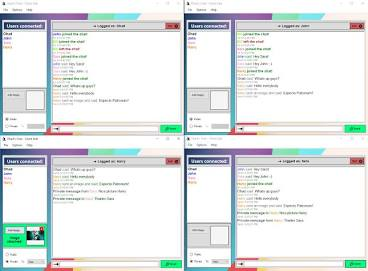

# Chat Uygulaması (C# / Windows Forms)

Bu proje, Nesne Tabanlı Programlama dersi kapsamında geliştirilmiş basit bir çok kullanıcılı sohbet uygulamasıdır. Aynı uygulamanın iki veya daha fazla örneği TCP soketleri üzerinden birbirine bağlanır. Açılış ekranında **Sunucu** veya **İstemci** modunu seçebilir, kullanıcı adınızı, IP adresinizi ve portu girebilirsiniz. Sunucu, bağlanan istemcilerden gelen mesajları diğer tüm istemcilere iletir.

## Kullanılan Teknolojiler

- C#
- .NET 8 (`net8.0-windows`)
- Windows Forms
- TCP Sockets (`System.Net.Sockets`: `TcpListener`, `TcpClient`)
- Threading / Tasks (istemci dinleme thread'i, sunucu için arka plan görevleri, `Invoke` / `BeginInvoke` ile arayüz güncelleme)

## Protokol

Bağlantı üzerinde UTF-8 kodlu, satır tabanlı (newline ile ayrılmış) bir metin protokolü kullanılır.

- Bağlantı kurulduğunda istemci **ilk satır** olarak kullanıcı adını gönderir.
- Bundan sonraki her satır tek bir mesajdır ve `zaman|gönderen|metin` biçimindedir. Zaman damgası ISO 8601 (`o`) biçimindedir.
- Metnin içindeki satır sonları boşluğa çevrilir. Metin kendi içinde `|` karakteri içerebilir; kullanıcı adındaki `|` karakteri ise `/` ile değiştirilir.
- Gönderen adı sunucu tarafında bağlantıdan alınır. Sistem mesajları (katıldı / ayrıldı) gönderen adı `Sistem` olarak yayınlanır.

## Çalıştırma Adımları

1. **.NET 8 SDK** kurun: <https://dotnet.microsoft.com/download/dotnet/8.0>
2. Depoyu klonlayın ve `ChatApp.csproj` dosyasını Visual Studio 2022 ile açın ya da terminalde proje klasöründe `dotnet run` komutunu çalıştırın.
3. Uygulamanın **iki örneğini** çalıştırın:
   - **Birinci örnek (sunucu):** Mod olarak **Sunucu** seçin, bir kullanıcı adı girin ve port olarak `5000` bırakın (ya da başka bir boş port seçin). **Başlat**'a basın.
   - **İkinci örnek (istemci):** Mod olarak **İstemci** seçin, farklı bir kullanıcı adı girin, IP adresi olarak `127.0.0.1` ve birinci örnekle aynı portu yazın. **Başlat**'a basın.
4. İki pencerede de mesaj yazıp **Enter** tuşu ya da **Gönder** düğmesi ile gönderin. Sunucu penceresinde bağlı kullanıcıların listesi görünür.

**Güvenlik duvarı notu:** Windows, uygulama ilk kez ağ dinlediğinde Windows Defender Güvenlik Duvarı uyarısı gösterebilir. Aynı bilgisayardaki iki örnek için **Özel ağlar** iznini vermeniz yeterlidir. Farklı bir bilgisayardan bağlanmak istiyorsanız sunucu bilgisayarında seçilen portun gelen bağlantılara izin verdiğinden emin olun ve istemci ekranına sunucunun yerel IP adresini girin.

## Ekran Görüntüleri

> Not: Ekran görüntüleri (`docs/screenshots/ekran1.png` ve `docs/screenshots/ekran2.png`) henüz eklenmedi. Uygulamayı Windows üzerinde iki örnek olarak çalıştırdıktan sonra bu dosyaları aynı klasöre ekleyin.
